# 01 · Product Requirements — Drive Alert

> **Status:** v0.2.0 (pre-release). Runs entirely on free, open services: OpenStreetMap data (ODbL), MapLibre + OpenFreeMap maps, OpenStreetMap notes for reports, and the policy hosted on GitHub.

## 1. Problem

Drivers in India increasingly encounter automated enforcement — fixed and mobile speed cameras, red-light cameras and ANPR — often with speed limits that change frequently along one road. Most drivers already navigate with Google Maps, which has no integration point for a third-party app to add warnings. Drivers need a calm, hands-free reminder of the posted limit **before** a known camera so they can check their speed and drive within the law, without touching the phone.

## 2. Goals

| # | Goal |
|---|------|
| G1 | Warn the driver, by voice and a heads-up notification, before a **verified** camera on the road they are actually travelling (correct direction, not the opposite carriageway or a crossing road). |
| G2 | Work while **Google Maps (or any app) is in front** and while the screen is locked, using only a user-started foreground service. |
| G3 | Be battery-light: adaptive location modes; precise GPS only near a relevant camera. |
| G4 | Privacy by design: location processed on the device; no trip history; no driver coordinates in alert history. |
| G5 | Encourage compliance: wording such as "Drive safely" / "Please slow down", never "avoid the fine". |
| G6 | Pass Google Play review: prominent disclosure, foreground-only location, honest data-safety answers. |

## 3. Non-goals (explicit)

- **Not an evasion tool.** The app does not help avoid enforcement, detect police, jam or detect radar, or rate the "best" places to speed. It shows the posted limit and asks the driver to comply.
- **Never reads Google Maps.** No accessibility-service scraping, no screen capture, no notification listener, no reading of Maps' route or ETA. Drive Alert uses only the phone's own location and its own camera database.
- Not turn-by-turn navigation; not a dash-cam; not a speed-limit database for every road.
- No guarantee of completeness: the app **never** claims to know every camera.
- No background location without a visible, user-started session (`ACCESS_BACKGROUND_LOCATION` is never requested).

## 4. Personas

| Persona | Context | Needs |
|---|---|---|
| **Priya — city commuter** (Bengaluru, 25 km/day) | Google Maps always on, music via Bluetooth | Short voice prompts that duck music; no clutter on top of Maps |
| **Rahul — highway driver** (Delhi ↔ Jaipur weekends) | Long expressway drives, tunnels/flyovers, 100+ km/h | Early enough warnings at speed; low battery drain over hours |
| **Fleet / cab driver** | 8–10 h shifts, phone on dashboard mount | Reliable while locked; auto-stop when parked; Hindi voice |
| **QA / Play reviewer** | Evaluating behaviour and compliance | Clear disclosure, Stop always one tap away, no hidden tracking |

## 5. Core user flow

```mermaid
flowchart LR
  A[Open app] --> B[Onboarding + prominent<br/>location disclosure]
  B --> C[Grant precise location<br/>+ notifications 13+]
  C --> D[Home: tap<br/>Start Camera Alerts]
  D --> E[Calibration:<br/>GPS accuracy check]
  E --> F[Start Drive →<br/>foreground service]
  F --> G[Switch to Google Maps]
  G --> H[Heads-up + voice<br/>warnings before cameras]
  H --> I[Stop from notification<br/>or in app / auto-stop]
```

Detailed flowcharts: [03-user-flows.md](03-user-flows.md).

## 6. Functional requirements

| ID | Requirement | Implemented by |
|---|---|---|
| FR-1 | Onboarding explains purpose, Maps limitation and safety, then shows the prominent location disclosure **before** the runtime request. | `ui/onboarding/OnboardingScreen.kt` |
| FR-2 | Alerts start only from a visible screen after a GPS calibration step; precise location is mandatory. | `ui/calibration/*`, `CameraAlertService.startSession()` |
| FR-3 | Persistent "Camera alerts active" notification with a **Stop alerts** action for the whole session. | `SessionNotificationFactory` |
| FR-4 | Warning bands 1000 / 500 / 200 m (user picks the first; optional closer reminders). Trigger distance compensates for speed, update interval and GPS accuracy. | `AlertDistances`, `AlertThresholdPolicy` |
| FR-5 | Each band fires at most once per camera per session; a passed camera stays silent for 30 min. | `SessionCameraTracker` |
| FR-6 | Ignore cameras behind, on the opposite carriageway, on crossing roads, and (unless close and precise) on service lanes / flyovers / parallel roads. | `CameraRelevanceEngine`, `BearingMatcher` |
| FR-7 | Output channels: heads-up notification (always), vibration, chime, TTS voice (each toggleable; "visual only" mode). Audio ducks music on the navigation-guidance stream. | `AlertCoordinator`, `VoiceAlertManager`, `AlertChimePlayer` |
| FR-8 | Stationary handling: "Has your drive ended?" after 10 min without movement, auto-stop after 30 min; traffic jams must not trigger it. | `StationaryDetector`, `DrivingSessionManager` |
| FR-9 | Service never restarts by itself (no boot receiver, `START_NOT_STICKY`). | `CameraAlertService` |
| FR-10 | Offline camera database per city/state package with incremental, validated sync; Wi-Fi by default. | `CameraSyncRepository`, `SyncScheduler` |
| FR-11 | Community reports (new / removed / wrong position, direction or limit / temporary mobile / duplicate / abuse) are rate-limited, de-duplicated, queued, and **never change alerts directly**. | `ReportModerationPolicy`, `ReportRepository` |
| FR-12 | Local alert history (no driver coordinates), clearable; 30-day retention. | `AlertHistoryRepository` |
| FR-13 | Setup assistant reads permission / battery / power-saver state and opens the closest system screen; OEM guidance (OnePlus first). | `BatteryRestrictionChecker`, `OemBatteryGuide`, `SystemSettingsIntents` |
| FR-14 | English and Hindi UI and voice (hi-IN TTS preferred when the app locale is Hindi). | `VoiceAlertManager.configureLanguage()` — Hindi strings **TODO** |

## 7. Camera types

| `CameraType` | User-facing name | Speed limit shown |
|---|---|---|
| `FIXED_SPEED` | Speed camera | Yes |
| `MOBILE_SPEED` | Mobile speed camera (usually temporary, `expires_at`) | Yes |
| `RED_LIGHT` | Red-light camera | If supplied |
| `SPEED_AND_RED_LIGHT` | Speed and red-light camera | Yes |
| `ANPR` | Number-plate (ANPR) camera | If supplied |
| `BUS_LANE` | Bus-lane camera | No |
| `RESTRICTED_ZONE` | Restricted-zone camera | No |
| `USER_REPORTED` | Reported camera (community) | If supplied |

Only `VERIFIED` and `COMMUNITY_CONFIRMED` records alert by default. `PENDING_VERIFICATION` / `DISPUTED` alert only if the user opts in ("Include unverified reports") and are labelled as unverified. `REJECTED` records are never stored.

## 8. Safety requirements

- **S1** No interaction needed while driving: audio first; notification text glanceable; no full-screen intents, overlays (`SYSTEM_ALERT_WINDOW`) or dialogs during a drive.
- **S2** Reporting while the vehicle moves (≥ 10 km/h during a session) is blocked unless the user confirms they are a passenger.
- **S3** Wording never implies avoiding penalties; over-limit adds "Please slow down".
- **S4** Disclaimer on Home and Camera Details: data may be incomplete or outdated; obey road signs.
- **S5** One-tap Stop from the notification at all times; auto-stop when parked.
- **S6** No racing, radar or "stealth" imagery or copy anywhere (see [07-ui-specifications.md](07-ui-specifications.md)).

## 9. Success criteria (targets to validate in field tests — not claims)

| Metric | Target | How measured |
|---|---|---|
| Correct first warning for verified, in-direction cameras on test routes (GPS ≤ 20 m) | ≥ 95 % | [14-oneplus13-device-test-checklist.md](14-oneplus13-device-test-checklist.md) |
| False warnings (opposite carriageway, crossing road, service lane) | ≤ 5 % of warnings | Same |
| Final warning lead time | ≥ 8 s at current speed | Alert history vs. drive log |
| Battery, 60 min drive with Maps navigating | ≤ 3 %/h attributable to Drive Alert (target) | [15-battery-profiling-report-template.md](15-battery-profiling-report-template.md) |
| Crash-free sessions | ≥ 99.5 % | Play Console vitals |
| Unexpected service kills (OnePlus 13, default settings) | 0 in 10 × 60 min drives | Device checklist |

## 10. Out of scope (v1)

Route-aware filtering using the Maps route · speed-limit data for roads without cameras · in-Maps overlays · Android Auto / CarPlay · wearables · accounts / login · server-side moderation tooling (separate project, see [server-api-contract.md](server-api-contract.md)) · map matching (hook exists, no provider).

## 11. Open questions

| # | Question | Owner | Status |
|---|---|---|---|
| Q1 | **Camera data licensing**: which official (state traffic police / smart-city) or licensed provider sources may legally be redistributed to app users? Each record needs a `source_reference`. | Product + Legal | **Resolved:** OpenStreetMap (ODbL) as the default source, with attribution; optional licensed server supported |
| Q2 | **Backend**: who operates `CAMERA_API_BASE_URL`, moderation queue and abuse handling? Hosting in India? | Product + Eng | **Resolved:** no server needed. Reports become public OSM notes (opt-in), reviewed by OSM volunteers |
| Q3 | Authentication / per-install identity for server-side report rate limiting. | Eng | Open |
| Q4 | Licensed map-matching provider for `RoadContextProvider` (reduces flyover / service-lane ambiguity). | Eng | Open |
| Q5 | Hindi copy review by a native speaker; other Indian languages? | Product | Open |
| Q6 | Privacy policy hosting (`PRIVACY_POLICY_URL`) and grievance officer contact under the DPDP Act 2023. | Legal | **Resolved:** [PRIVACY.md](../PRIVACY.md) on GitHub; contact via GitHub Issues (a named grievance officer is still advisable for a commercial release) |
