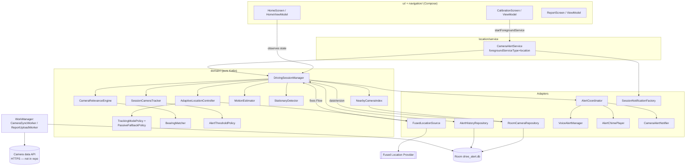
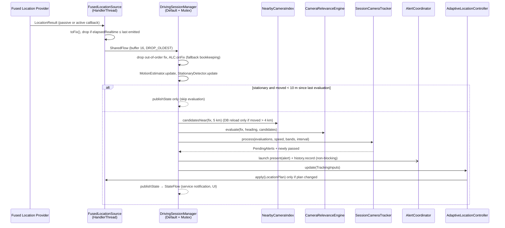

# 02 · Technical Architecture

Single-module Android app (`:app`), Kotlin 2.2, Jetpack Compose + Material 3, Hilt, Room, DataStore, WorkManager, Fused Location Provider, Retrofit + kotlinx.serialization. `minSdk 26`, `targetSdk/compileSdk 36`.

## 1. Layers and packages

All code lives under `app/src/main/java/com/drivealert/app/`.

| Package | Layer | Responsibility |
|---|---|---|
| `domain/` | **Core (pure Kotlin)** | All decision logic. No `android.*` imports; depends only on `kotlinx.coroutines`. |
| `domain/geo` | Core | `GeoMath` (haversine, bearings, along/cross-track), `GridCell` (0.02° spatial grid). |
| `domain/model` | Core | `Camera`, `LocationFix`, `TrackingMode`, `LocationPlan`, `SessionState`, `AlertSettings`… |
| `domain/relevance` | Core | `MotionEstimator`, `BearingMatcher`, `CameraRelevanceEngine`. |
| `domain/alerts` | Core | `AlertThresholdPolicy`, `SessionCameraTracker`. |
| `domain/location` | Core | `TrackingModePolicy`, `PassiveFallbackPolicy`, `AdaptiveLocationController`, `StationaryDetector`, `DeadReckoning`. |
| `domain/cameras` | Core | `NearbyCameraIndex` (in-memory spatial cache), `NearbyCameras` (nearest cameras with distance and bearing from the user, for "Cameras near you"). |
| `domain/session` | Core | `DrivingSessionManager` (orchestrator). |
| `domain/reporting` | Core | `ReportModerationPolicy` (client checks + reference server scoring). |
| `domain/ports` | Core | Interfaces to the platform: `LocationSource`, `CameraLookup`, `AlertPresenter`, `AlertHistoryRecorder`, `RoadContextProvider`, `Clock`. |
| `location/` | Adapter | `FusedLocationSource` (implements `LocationSource`), `ForegroundLocationProbe` (UI-only reads), `LocationMapping`. |
| `location/service` | Adapter | `CameraAlertService` — the location foreground service. |
| `alerts/` | Adapter | `AlertCoordinator` (implements `AlertPresenter`), `AlertTextFormatter`, `HapticAlerter`. |
| `notifications/` | Adapter | Channels, heads-up `CameraAlertNotifier`, `SessionNotificationFactory`, `NotificationIntents`. |
| `speech/` | Adapter | `VoiceAlertManager` (TTS), `AlertChimePlayer` (synthesised tone), `AudioFocusHelper`. |
| `cameras/` | Adapter | `CameraRepository` / `RoomCameraRepository` (implements `CameraLookup`). |
| `database/` | Adapter | Room entities, DAOs, mappers, `DriveAlertDatabase`. See [04-database-schema.md](04-database-schema.md). |
| `network/` | Adapter | `CameraDataApi` (Retrofit), DTOs, `CameraRecordValidator`, `ApiConfig`. |
| `data/sync`, `data/history`, `data/testdata` | Adapter | Sync repository/worker/scheduler; `AlertHistoryRepository` (implements `AlertHistoryRecorder`); synthetic dataset parser. |
| `reporting/` | Adapter | `ReportRepository`, `ReportUploadWorker`. |
| `settings/` | Adapter | `SettingsRepository` (DataStore `drive_alert_settings`). |
| `permissions/` | Adapter | `LocationPermissions` helpers. |
| `battery/` | Adapter | `BatteryRestrictionChecker`, `OemBatteryGuide`, `SystemSettingsIntents`. |
| `ui/`, `navigation/` | Presentation | Compose screens + `@HiltViewModel`s, type-safe routes. See [07-ui-specifications.md](07-ui-specifications.md). |
| `di/` | Wiring | `AppModule`, `BindingsModule`, `@ApplicationScope`. |
| `util/` | Shared | `AppLog` (privacy-safe logging), `SystemClockImpl`. |

## 2. Ports and adapters

The domain owns the interfaces in `domain/ports/Ports.kt`; Android code implements them. A complete drive (fixes → alerts → mode changes) can therefore run in a plain JVM unit test with fake ports and a fake `Clock`.

| Port | Production adapter | Test double |
|---|---|---|
| `LocationSource` | `FusedLocationSource` | Fake emitting scripted `LocationFix`es; records applied `LocationPlan`s |
| `CameraLookup` | `RoomCameraRepository.camerasInCells()` | In-memory list |
| `AlertPresenter` | `AlertCoordinator` | Recorder of presented `CameraAlert`s |
| `AlertHistoryRecorder` | `AlertHistoryRepository` | Recorder |
| `RoadContextProvider` | **none configured** (`null` in `AppModule`) — needs a licensed road-data provider; must never read another app's route or screen | Fake returning `RoadMatch` |
| `Clock` | `SystemClockImpl` (`elapsedRealtime` counts deep sleep) | Virtual time |

## 3. Component diagram

## 4. Data flow per GPS fix

A parallel tick loop (every 3 s in `CLOSE`, 15 s otherwise) runs `ALC.onTick()` (passive staleness), dead reckoning during short GPS gaps, and the stationary prompt / auto-stop timers. Details and constants: [05-algorithms.md](05-algorithms.md).

## 5. Threading and concurrency

| Concern | Mechanism |
|---|---|
| Location callbacks | Dedicated `HandlerThread("drive-alert-location")`, created lazily by `FusedLocationSource.looper()`, `quitSafely()` on `stop()`. The main thread is never woken for fixes. |
| Session processing | Coroutines in the service's `lifecycleScope` on `Dispatchers.Default` (`workContext`). A single **`Mutex`** serialises fix handling, ticks, data-version invalidation and `confirmDriveContinues()`; `MotionEstimator`, `StationaryDetector`, `SessionCameraTracker` and `NearbyCameraIndex` are therefore single-threaded by construction. |
| Subscription race | Fix and data-version collectors start with `CoroutineStart.UNDISPATCHED` **before** `locationController.start()` so the first fix is never lost. |
| Stop vs. in-flight fix | `AdaptiveLocationController` methods are `@Synchronized` (`mode`, `planChanges` are `@Volatile`), and `FusedLocationSource.apply/stop` are `@Synchronized`, so a fix processed on a worker can never re-register a request after `stop()` removed all callbacks. `stop()` is called from the main thread outside the mutex. |
| Presentation | Each alert is presented in its own coroutine (`runCatching`), so TTS start-up or the chime (~370 ms) never blocks location processing. |
| TTS | `VoiceAlertManager.initialize/shutdown` are `@Synchronized`; `speak()` waits ≤ 3 s for engine readiness. |
| Long-lived writes | `@ApplicationScope` (`SupervisorJob + Dispatchers.Default`) for DataStore writes that must outlive the service (`setSessionMarkedActive`). |
| Database / network | Room suspend DAOs; WorkManager `CoroutineWorker`s; never on the location thread. |

## 6. DI graph (Hilt, `SingletonComponent`)

- **`BindingsModule`** (`@Binds`): `FusedLocationSource → LocationSource`, `AlertCoordinator → AlertPresenter`, `AlertHistoryRepository → AlertHistoryRecorder`, `RoomCameraRepository → CameraRepository`, `SystemClockImpl → Clock`.
- **`AppModule`** (`@Provides @Singleton`): `@ApplicationScope CoroutineScope`; `DriveAlertDatabase` (`drive_alert.db`) and its four DAOs; `DataStore<Preferences>`; `OkHttpClient` (15 s connect / 30 s read, cert pinning **TODO**); `CameraDataApi` (placeholder `https://camera-api.not-configured.invalid/` when unconfigured); `StateFlow<AlertSettings>` (eager); `TrackingModePolicy`, `AlertThresholdPolicy`, `CameraRelevanceEngine`, `ReportModerationPolicy` with default configs; `NearbyCameraIndex(CameraRepository)`; `AdaptiveLocationController`; `DrivingSessionManager` (with `dataVersion = cameras.dataVersion`, `roadContextProvider = null`, `workContext = Dispatchers.Default`).
- **Build-type modules**: `debug/…/DebugToolsModule` binds `DebugTestDataTools`; `release/…/ReleaseToolsModule` binds `NoOpTestDataTools` (both implement `TestDataTools`).
- **Workers**: `@HiltWorker` + `HiltWorkerFactory`; the default WorkManager initializer is removed in the manifest and `DriveAlertApp` provides `Configuration`.
- `DrivingSessionManager` is a singleton shared by `CameraAlertService`, `HomeViewModel` and `ReportViewModel` (read-only state).

## 7. Key components

| Component | Class / file | Notes |
|---|---|---|
| DrivingSessionManager | `domain/session/DrivingSessionManager.kt` | Session lifecycle, fix pipeline, tick loop, `StateFlow<SessionState>`, `SharedFlow<SessionEvent>` |
| AdaptiveLocationController | `domain/location/AdaptiveLocationController.kt` | Applies `TrackingModePolicy` plans; `planChanges` counter |
| CameraRepository | `cameras/CameraRepository.kt` (`RoomCameraRepository`) | Cell queries (chunked 500), all-active list for the clustered map (`allActive`, up to 5,000), search for UI, `dataVersion` |
| NearbyCameraIndex | `domain/cameras/NearbyCameraIndex.kt` | 12 km cache, reload after 4 km; `loadCount` counter |
| CameraRelevanceEngine | `domain/relevance/CameraRelevanceEngine.kt` | Per-camera relevance + confidence |
| BearingMatcher | `domain/relevance/BearingMatcher.kt` | Direction match, ahead/beside/behind |
| AlertCoordinator | `alerts/AlertCoordinator.kt` | Notification → vibration → chime → voice |
| AlertHistoryRepository | `data/history/AlertHistoryRepository.kt` | Local only, no driver coordinates, prune by retention |
| VoiceAlertManager | `speech/VoiceAlertManager.kt` | TTS per session; `QUEUE_FLUSH`; en-IN / hi-IN |
| BatteryRestrictionChecker | `battery/BatteryRestrictionChecker.kt` | Reads readiness; never changes settings |
| CameraSyncWorker | `data/sync/CameraSyncWorker.kt` | Catalog refresh + delta sync, ≤ 3 attempts |

## 8. Process and lifecycle rules

- The service starts only via `CameraAlertService.start()` from a visible activity (calibration "Start Drive"); it refuses to start without **precise** location and calls `startForeground(…, FOREGROUND_SERVICE_TYPE_LOCATION)` immediately.
- `START_NOT_STICKY`; a null intent (system re-creation) → `stopSelf()`. No `BOOT_COMPLETED` receiver.
- `settings.sessionMarkedActive` is set while a session runs; if the app later finds it `true` with no running session, Home shows "alerts stopped unexpectedly" and links to the setup assistant.
- Sync and report upload are disabled when `ApiConfig.isConfigured` is false (base URL must start with `https://`).
