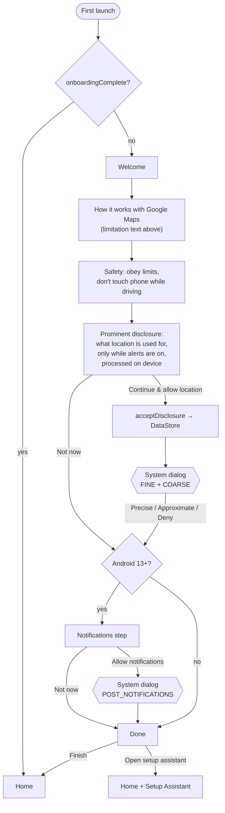
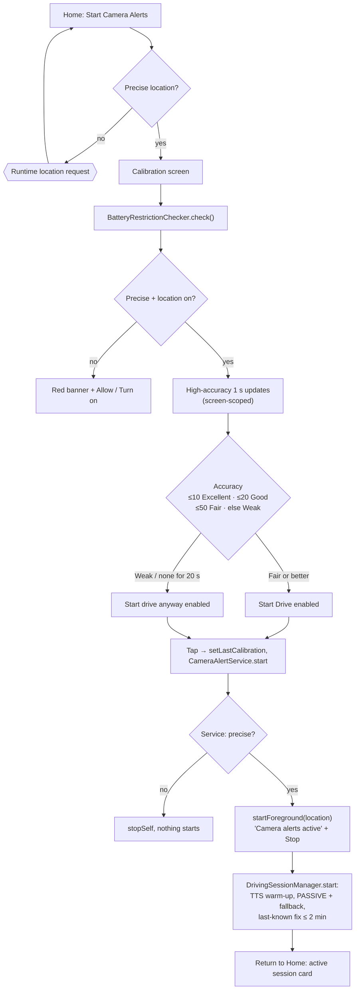
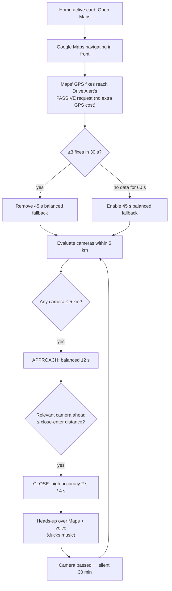
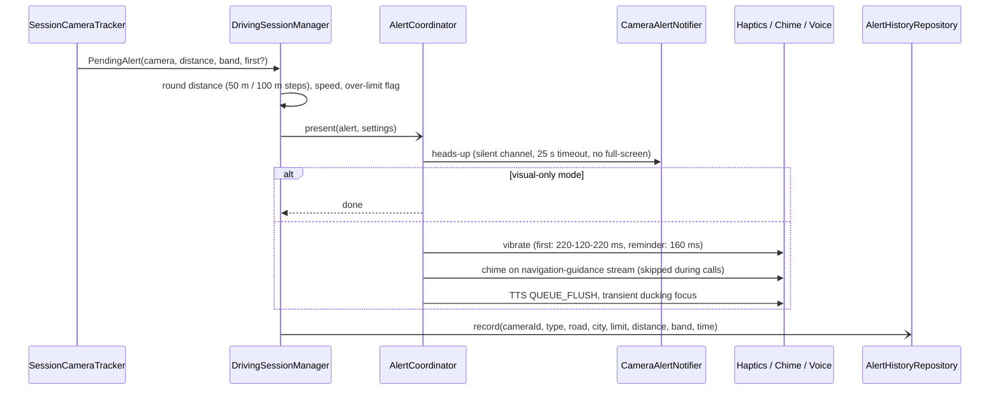
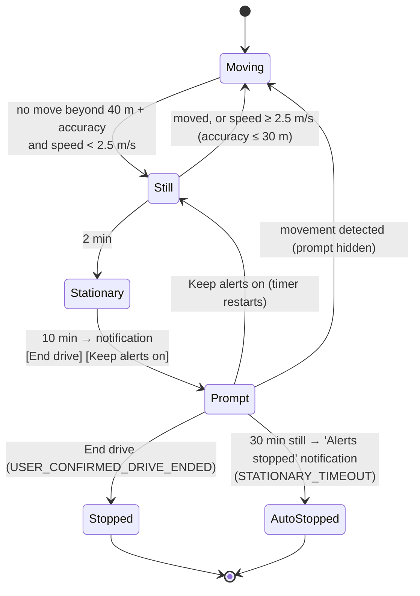
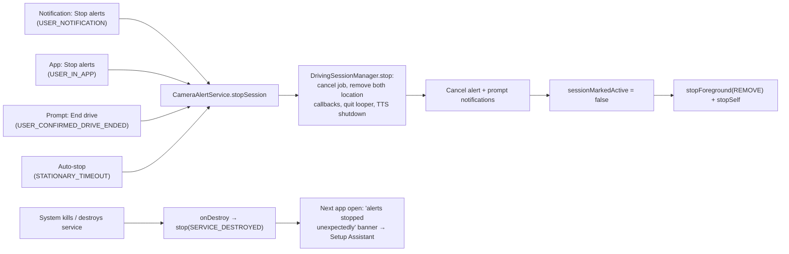
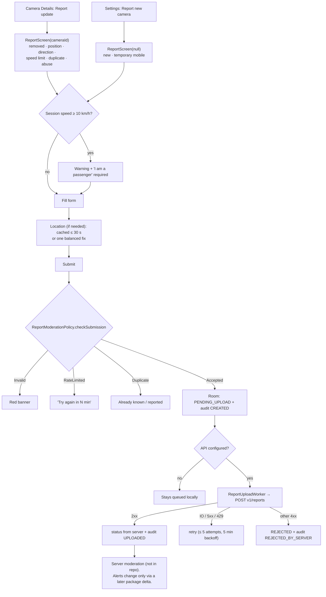
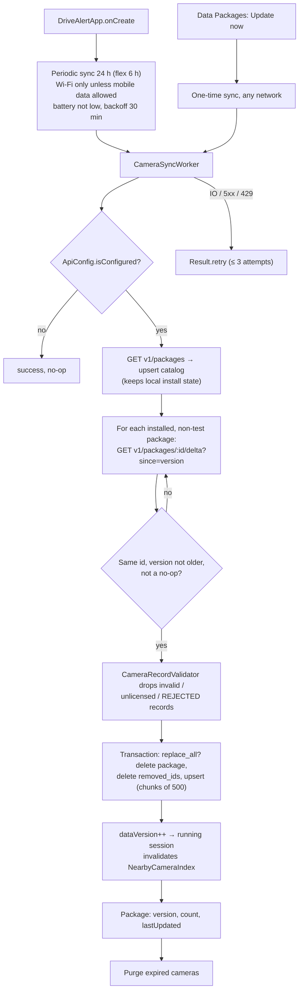

# 03 · User Flows

All flows reflect the current code; screen details are in [07-ui-specifications.md](07-ui-specifications.md).

## Google Maps limitation (honest wording — use in onboarding and store listing)

> **Drive Alert works alongside Google Maps but is not connected to it.** It never reads your Maps route, destination, screen or notifications. It uses your phone's own location and Drive Alert's own camera database. This means:
> - It warns about cameras on the road you are actually driving, whether or not Maps is navigating.
> - Warnings cannot appear *inside* the Google Maps screen. They appear as a short notification at the top of the screen and as a voice message.
> - It does not know which turn you will take next, so it may warn about a camera on a road you are about to leave.
> - Camera data may be incomplete or out of date. Always follow road signs and the posted speed limit.

---

## 1. First run: onboarding and permissions

Steps come from `OnboardingScreen` (`Step` enum). The prominent location disclosure is its own step and is shown **before** the system dialog.

Outcomes on Home: approximate-only → red banner "Precise location needed"; location services off → "Turn on"; other readiness warnings (notifications, background restriction, power saver) → amber "Review" banner → Setup Assistant.

## 2. Start a drive (calibration → service)

Calibration's 1 s high-accuracy request is removed as soon as the screen stops collecting (`WhileSubscribed(1 s)`).

## 3. Active drive with Google Maps in front

## 4. Alert sequence

## 5. Stationary, "Has your drive ended?" and auto-stop

Traffic jams: any displacement beyond the radius or a measured speed ≥ 2.5 m/s (9 km/h) restarts the clock, so stop-and-go traffic never reaches the prompt. While stationary, camera evaluation is skipped unless the position moved ≥ 10 m.

## 6. Stop flows

- **Swipe from Recents:** the foreground service keeps running (no `stopWithTask`); stop via the notification.
- **Reboot:** nothing restarts (no boot receiver; `START_NOT_STICKY`; a null restart intent calls `stopSelf()`).

## 7. Community report flow

## 8. Sync flow

Only package ids and data versions are sent; the driver's location never is.
