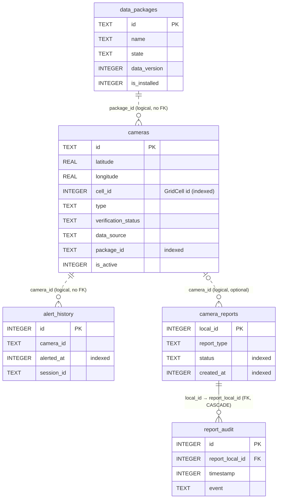

# 04 · Database Schema

Room database `drive_alert.db` (`DriveAlertDatabase`, **version 1**, `exportSchema = true`). Source: `app/src/main/java/com/drivealert/app/database/Entities.kt`, `Daos.kt`, `Mappers.kt`.

Conventions: enums are stored **by name** as `TEXT` (decoded with `enumOrDefault`, so unknown values fall back safely); timestamps are epoch milliseconds (`INTEGER`); Kotlin `Boolean` is `INTEGER` 0/1; nullable Kotlin types are nullable columns, all others `NOT NULL`.

## ER diagram

## `cameras` — downloaded camera records (`CameraEntity`)

| Column | Type | Null | Purpose |
|---|---|---|---|
| `id` | TEXT **PK** | no | Server id (synthetic test records use `TEST-…`) |
| `latitude`, `longitude` | REAL | no | WGS84 position of the camera |
| `cell_id` | INTEGER | no | `GridCell.cellId(lat, lon)` — spatial index key, computed in `Camera.toEntity()` |
| `type` | TEXT | no | `CameraType` name |
| `road_name`, `city`, `state` | TEXT | yes | Display + search; `road_name` also used for map-match name comparison |
| `bearing_deg` | REAL | yes | Monitored travel direction, degrees from north |
| `directionality` | TEXT | no | `ONE_DIRECTION` / `BOTH_DIRECTIONS` / `UNKNOWN` |
| `speed_limit_kmh` | INTEGER | yes | Posted limit (validated 5–150) |
| `verification_status` | TEXT | no | `VerificationStatus` name (`REJECTED` never stored by sync) |
| `verification_count` | INTEGER | no | Distinct confirmations (display) |
| `data_source` | TEXT | no | `DataSource` name |
| `source_reference` | TEXT | yes* | Licence / provenance reference (*required by `CameraRecordValidator` for synced data) |
| `last_verified_at` | INTEGER | yes | Last verification time |
| `confidence_score` | REAL | no | Data-quality score 0–1 from the pipeline |
| `expires_at` | INTEGER | yes | Temporary/mobile cameras stop alerting and are purged after this |
| `is_active` | INTEGER | no | Inactive rows are excluded from every query |
| `road_context` | TEXT | no | `RoadContext` (service lane, flyover, …) |
| `road_segment_id` | TEXT | yes | Map-matching segment id from a licensed provider |
| `elevation_m` | REAL | yes | WGS84 **ellipsoidal** height (comparable to GNSS altitude) |
| `package_id` | TEXT | no | Owning data package |
| `is_test_data` | INTEGER | no | 1 for TEST-ONLY synthetic records |
| `updated_at` | INTEGER | no | Local write time |

**Indices:** `index_cameras_cell_id (cell_id)`, `index_cameras_package_id (package_id)`, `index_cameras_latitude_longitude (latitude, longitude)`.

Main queries: `activeInCells(cellIds)` (session cache, chunked to 500 ids), `activeInBounds(...) LIMIT 300` (map markers), `search(query) LIMIT 20` (road/city/state `LIKE`), `applyDelta(...)` (`@Transaction`), `deleteExpired(now)`, `deleteTestData()`.

## `data_packages` — city/state packages (`DataPackageEntity`)

| Column | Type | Null | Purpose |
|---|---|---|---|
| `id` | TEXT **PK** | no | Package id from `GET v1/packages` |
| `name`, `state` | TEXT | no | Display |
| `city` | TEXT | yes | Display |
| `data_version` | INTEGER | no | Last applied server version; next delta asks `since=` this (0 = never synced) |
| `camera_count` | INTEGER | no | Active cameras in the package (recounted after each delta) |
| `last_updated_at` | INTEGER | yes | Last successful sync for the package |
| `is_installed` | INTEGER | no | User selected this package for offline use |
| `coverage_note` | TEXT | yes | Server-supplied coverage caveat shown to the user |
| `is_test_data` | INTEGER | no | 1 for the synthetic test package (skipped by sync) |

## `alert_history` — local-only alert log (`AlertHistoryEntity`)

| Column | Type | Null | Purpose |
|---|---|---|---|
| `id` | INTEGER **PK** autoincrement | no | |
| `camera_id` | TEXT | no | Announced camera |
| `camera_type` | TEXT | no | Snapshot of the type |
| `road_name`, `city` | TEXT | yes | Snapshot for display (survives package removal) |
| `speed_limit_kmh` | INTEGER | yes | Snapshot |
| `alert_distance_m` | INTEGER | no | Announced (rounded) distance |
| `threshold_m` | INTEGER | no | Band that fired (1000/500/200) |
| `alerted_at` | INTEGER | no | Time of the alert (**indexed** `index_alert_history_alerted_at`) |
| `session_id` | TEXT | no | Random UUID per drive; groups alerts of one session |

## `camera_reports` — reports created on this device (`CameraReportEntity`)

| Column | Type | Null | Purpose |
|---|---|---|---|
| `local_id` | INTEGER **PK** autoincrement | no | Local id; also part of `client_report_id` |
| `remote_id` | TEXT | yes | Server report id after upload |
| `report_type` | TEXT | no | `ReportType` name |
| `camera_id` | TEXT | yes | Existing camera (not for new/temporary reports) |
| `latitude`, `longitude` | REAL | yes | Reported position — only for `NEW_CAMERA`, `TEMPORARY_MOBILE_CAMERA`, `INCORRECT_POSITION` |
| `bearing_deg` | REAL | yes | Reserved (not set by the current UI) |
| `speed_limit_kmh` | INTEGER | yes | For `INCORRECT_SPEED_LIMIT` (10–150, multiple of 5) |
| `camera_type` | TEXT | yes | For new/temporary reports |
| `note` | TEXT | yes | Free text, ≤ 500 chars |
| `created_at` | INTEGER | no | **indexed** (`index_camera_reports_created_at`) — used for rate limiting |
| `status` | TEXT | no | `ReportStatus` name — **indexed** (`index_camera_reports_status`) |
| `expires_at` | INTEGER | yes | Temporary: +4 h; others: +30 days; `expireOld()` marks open reports `EXPIRED` |
| `last_error` | TEXT | yes | e.g. `HTTP 400` |

## `report_audit` — append-only report lifecycle (`ReportAuditEntity`)

| Column | Type | Null | Purpose |
|---|---|---|---|
| `id` | INTEGER **PK** autoincrement | no | |
| `report_local_id` | INTEGER **FK** → `camera_reports.local_id` `ON DELETE CASCADE` | no | **indexed** (`index_report_audit_report_local_id`) |
| `timestamp` | INTEGER | no | Event time |
| `event` | TEXT | no | `CREATED`, `UPLOADED`, `REJECTED_BY_SERVER` |
| `detail` | TEXT | yes | Report type / server status / HTTP code |

## Grid-cell spatial index

`GridCell` divides the globe into fixed **0.02° × 0.02°** cells (18,000 columns). Cell id = `row × 18000 + col`, where `row = ⌊(lat + 90) / 0.02⌋` and `col = ⌊(lon + 180) / 0.02⌋`. A cell is ≈ 2.2 km north–south and ≈ 2.2 km (8° N) to 1.8 km (35° N) east–west across India.

1. On write, every camera stores its `cell_id`.
2. `GridCell.cellsCovering(lat, lon, r)` returns every cell intersecting the bounding square of radius `r`.
3. `NearbyCameraIndex` loads a **12 km** radius (≈ 12 × 14 = 168 cells near Delhi) with one indexed `cell_id IN (…)` query, groups rows by cell in memory, and answers each fix by scanning only the ≈ 36 cells within 5 km, followed by an exact haversine filter.
4. The database is queried again only after the driver moves > 4 km from the load point, or when `dataVersion` changes (sync / test-data load).

The `(latitude, longitude)` index serves the map's bounding-box query instead.

## Privacy notes

- **No driver coordinates are stored in `alert_history`** — only which camera was announced and when. Because camera positions are known, history still implies roads travelled: treat it as location-derived personal data. It is local-only, excluded from backup, clearable (`AlertHistoryRepository.clear()`), and pruned to **30 days** at app start (`historyRetentionDays`, currently not user-adjustable).
- `camera_reports` stores the coordinates the user chose to report (normally where they were). These are uploaded when the server is configured; `deleteAllLocalReports()` removes local copies (audit rows cascade).
- No table stores trips, routes or raw GPS fixes. `LocationFix` objects live only in memory during a session.
- `android:allowBackup="false"`, `fullBackupContent="false"` and `data_extraction_rules.xml` exclude the database, preferences and files from cloud backup and device transfer.

## Migration policy

- The Room Gradle plugin exports schemas to **`app/schemas/`** (`room { schemaDirectory("$projectDir/schemas") }`). The JSON for version 1 is generated on the first build — **commit it**.
- Every schema change: bump `version`, add a `Migration` (or `@AutoMigration` with a spec) and a `MigrationTestHelper` test against the exported JSON. Do not use `fallbackToDestructiveMigration()` for user data (`alert_history`, `camera_reports`).
- Camera and package tables are re-downloadable; if a destructive change is ever unavoidable there, reset `data_packages.data_version` to 0 so the next sync requests a full `replace_all` snapshot.
- Keep enum names stable; renaming an enum constant silently maps stored rows to the default value.
