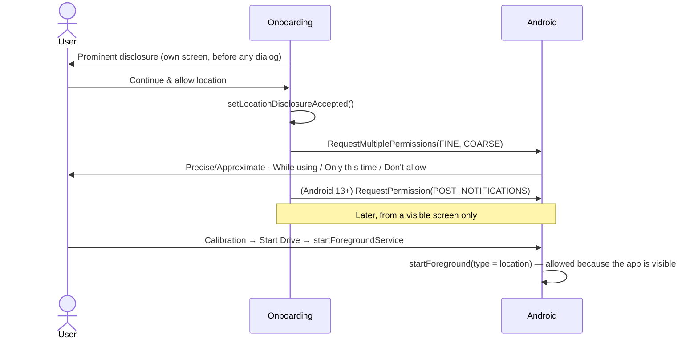

# 06 · Permissions and Battery Setup

## 1. Declared permissions (`AndroidManifest.xml`)

| Permission | Why |
|---|---|
| `ACCESS_FINE_LOCATION` + `ACCESS_COARSE_LOCATION` | Foreground ("while using the app") location. **Precise is mandatory** to start alerts. |
| `FOREGROUND_SERVICE` + `FOREGROUND_SERVICE_LOCATION` | `CameraAlertService` with `android:foregroundServiceType="location"` (type-specific permission required on Android 14+). |
| `POST_NOTIFICATIONS` | Session notification and heads-up warnings (runtime on Android 13+). |
| `VIBRATE` | Optional haptic warning. |
| `INTERNET`, `ACCESS_NETWORK_STATE` | Camera data sync and report upload (HTTPS only). |

**Deliberately not declared:** `ACCESS_BACKGROUND_LOCATION`, `REQUEST_IGNORE_BATTERY_OPTIMIZATIONS`, `SYSTEM_ALERT_WINDOW`, `USE_FULL_SCREEN_INTENT`, `RECEIVE_BOOT_COMPLETED`.

## 2. Permission sequence

Rules:

1. **Disclosure first.** The disclosure (purpose; used only while camera alerts are on, including when another app such as Google Maps is in front or the screen is locked; processed on the device; not shared or sold) is shown and accepted before the system dialog.
2. **Notifications** are requested on Android 13+ only. Without them the service still runs and voice/chime/vibration still work, but no heads-up appears — the setup assistant flags this.
3. **Never background location.** The session is a user-started location foreground service; Android grants location to it under the "while in use" permission because it is started from a visible activity.
4. **Approximate only** → `CameraAlertService` refuses to start (`hasPreciseLocation()`), and Home / Calibration show "Precise location needed".
5. **"Only this time"**: Android keeps the one-time grant while the foreground service started from the visible app runs; the user is asked again on a later drive.
6. **Permanently denied** (denied twice): the system no longer shows the dialog; the UI should send the user to *App info → Permissions* via `SystemSettingsIntents.openAppDetails()` (see discrepancy note in §6).

## 3. Setup assistant checks (`BatteryRestrictionChecker.check()` → `DeviceReadiness`)

The checker **reads, never changes** settings. Every intent in `SystemSettingsIntents` falls back to the app's details page, which exists on all builds including OxygenOS.

| Check | Read from | Severity | Opens |
|---|---|---|---|
| Precise location | `checkSelfPermission(ACCESS_FINE_LOCATION)` | Blocks start | Runtime request (after disclosure) / `ACTION_APPLICATION_DETAILS_SETTINGS` |
| Approximate only | coarse granted, fine not | Warning | Same |
| Location services on | `LocationManagerCompat.isLocationEnabled` | Blocks start | `ACTION_LOCATION_SOURCE_SETTINGS` |
| Notifications allowed | `POST_NOTIFICATIONS` (13+) + `areNotificationsEnabled()` | Warning | `ACTION_APP_NOTIFICATION_SETTINGS` |
| "Camera alerts" channel enabled | channel `camera_alerts` importance ≠ `NONE` | Warning | `ACTION_APP_NOTIFICATION_SETTINGS` |
| Background restricted | `ActivityManager.isBackgroundRestricted` (Android 9+) | Warning | App details → Battery + OEM guide |
| Power saving mode | `PowerManager.isPowerSaveMode` | Warning | `ACTION_BATTERY_SAVER_SETTINGS` |
| Battery optimisation | `isIgnoringBatteryOptimizations()` | Info only | `ACTION_IGNORE_BATTERY_OPTIMIZATION_SETTINGS` (list screen; never the direct request) |
| App standby bucket | `UsageStatsManager.appStandbyBucket` (9+) | Info only | — |
| Device family | `Build.MANUFACTURER` / `BRAND` → `DeviceFamily` | — | `OemBatteryGuide` text |
| App language | — | — | `ACTION_APP_LOCALE_SETTINGS` (13+) / `ACTION_LOCALE_SETTINGS` |

`canStartAlerts = precise && locationServicesEnabled`. `warningCount` = notifications/channel off + background restricted + power saver + approximate only; Home shows an amber "Review" banner when it is > 0. If a session was killed (`sessionMarkedActive` still true), Home shows "alerts stopped unexpectedly" with a link here.

## 4. OnePlus 13 / OxygenOS guidance (`DeviceFamily.ONEPLUS_OPPO_REALME`)

OnePlus, Oppo and Realme share ColorOS-based battery management, which is the most common reason a foreground service stops on these devices.

**Recommended path (OnePlus 13):**

> **Settings → Battery → More settings → App battery management → Drive Alert → Allow background activity**

Alternative route: **Settings → Apps → Drive Alert → Battery usage → Allow background activity**.

> **Note:** Menu names and positions **differ between OxygenOS releases** (e.g. OxygenOS 15 vs 16) and regional builds. The in-app guide says so explicitly and always offers *Open app settings* as the fallback. Re-verify the path on each OxygenOS update (see [14-oneplus13-device-test-checklist.md](14-oneplus13-device-test-checklist.md)).

Also on OxygenOS:

- Keep **Battery saver / Power saving mode** off for long drives, or verify alerts still arrive with it on.
- Optionally **lock the app in Recents** (Recents → app menu → Lock) to reduce aggressive clean-up.
- **Auto-launch is not needed** — Drive Alert must never start by itself.

## 5. Other OEMs (typical paths; wording varies by release)

| Family | Typical setting |
|---|---|
| Samsung (One UI) | Settings → Apps → Drive Alert → Battery → **Unrestricted** or **Optimised** (not Restricted); ensure it is not in Settings → Battery → Background usage limits → Sleeping / Deep sleeping apps |
| Xiaomi / Redmi / POCO (HyperOS, MIUI) | Settings → Apps → Manage apps → Drive Alert → Battery saver → **No restrictions** |
| vivo / iQOO (Funtouch OS, OriginOS) | Settings → Battery → Background power consumption management → Drive Alert → **Allow** |
| Google Pixel, Motorola, Nothing (near-stock) | Settings → Apps → Drive Alert → App battery usage → **Optimised** is fine; avoid **Restricted** |
| Other | App info → Battery → allow background activity; turn off battery saver for long drives |

## 6. Why unrestricted battery access is not requested

- A running **location foreground service** keeps receiving location updates under Doze and App Standby; Drive Alert does not need a battery-optimisation exemption to work with Android's default *Optimised* setting.
- Google Play restricts `REQUEST_IGNORE_BATTERY_OPTIMIZATIONS` to apps whose core function cannot work otherwise; requesting it would invite review friction and signal "always-on" behaviour the app intentionally avoids.
- An exemption would also exempt the app from limits outside drives, which conflicts with the "nothing runs when alerts are off" promise.
- What *can* break alerts is the user/OEM **"Restrict"** setting (Android background restriction or OxygenOS *Restrict background activity*). The setup assistant detects the Android flag and explains the OEM switch; it never flips it automatically.

## Discrepancy notes (code vs. intended behaviour)

- Home and Calibration "Allow" banners launch the runtime location request directly. If the user tapped *Not now* on the onboarding disclosure (`locationDisclosureAccepted == false`), the disclosure should be shown again first; and after a permanent denial the banner should open App info instead.
- The "Camera alerts" channel check opens the app notification screen, not the channel screen (`ACTION_CHANNEL_NOTIFICATION_SETTINGS` would be more direct).
- The Setup Assistant screen (`ui/setup/SetupAssistantScreen.kt`) is still being written; this document describes its intended behaviour from the checker API.
